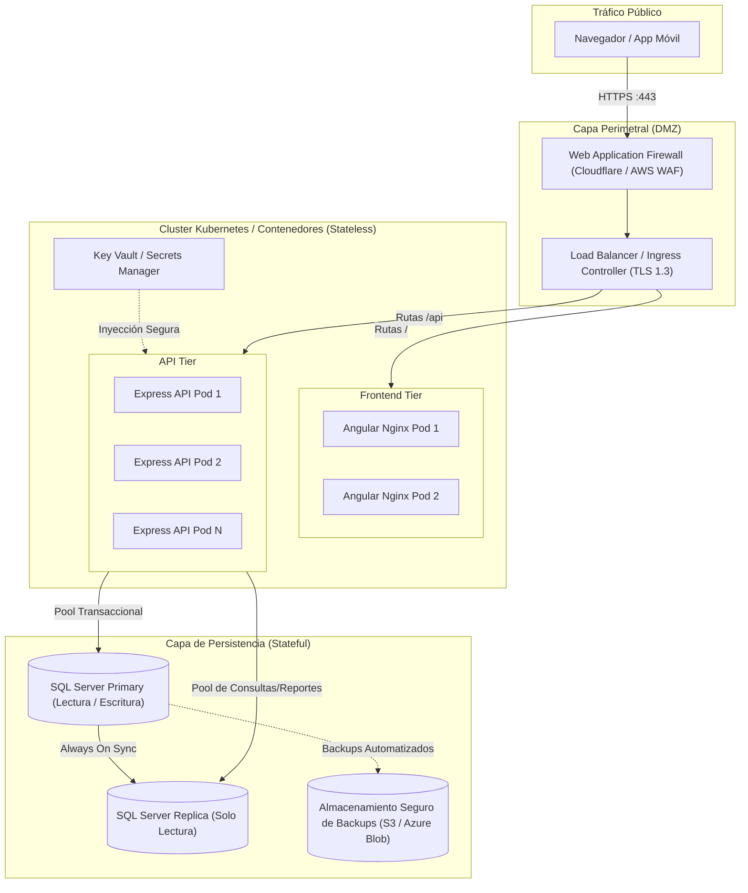
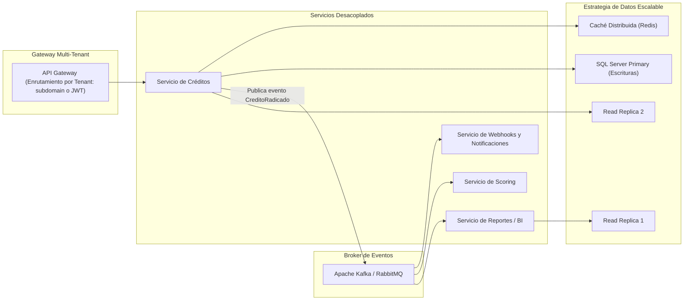

# Documento de Decisiones Técnicas y Sustentación de Arquitectura
**Prueba Técnica — Desarrollador Semi Senior · Sector Financiero Solidario**
**Entidad:** OPA SAS | **Módulo:** Administración y Ciclo de Vida de Solicitudes de Crédito

---

## 1. Justificación del Modelo de Base de Datos y Persistencia

### A. Tipos de Datos Financieros y Precisión Numérica
- **Regla estricta:** En sistemas financieros queda terminantemente prohibido el uso de tipos de coma flotante (`float`, `real`, `double`) para montos y tasas de interés. Los tipos IEEE 754 sufren de imprecisiones de redondeo binario que generan discrepancias contables en acumulados.
- **Implementación:**
  - `valorSolicitado`: `DECIMAL(18,2)`, permitiendo montos de hasta 16 dígitos enteros con 2 decimales exactos.
  - `tasaInteres`: `DECIMAL(5,2)`, soportando tasas porcentuales con precisión de dos decimales (ej: `1.45%`).
- **Manejo de Fechas:** Se utiliza `DATETIME2(7)` con `SYSUTCDATETIME()`. Todas las marcas temporales se normalizan en formato UTC a nivel de motor para eliminar ambigüedades derivadas de cambios de horario o servidores en distintas zonas horarias.

### B. Llaves, Integridad Referencial e Índices
- **Llaves Primarias:** Subrogadas mediante `IDENTITY(1,1) INT` para garantizar que los índices agrupados (*Clustered Indexes*) permanezcan compactos, de longitud fija y secuenciales, evitando fragmentación de páginas de datos.
- **Identificadores Comerciales:** Se genera un `numeroCredito` estructurado (`CR-YYYY-XXXXXX`) con restricción de unicidad (`UQ_Creditos_numeroCredito`) para consulta y conciliación humana/contable.
- **Integridad Referencial:**
  - `FK_Creditos_Asociados`: Con `ON DELETE NO ACTION` para impedir la eliminación accidental de un asociado que tenga antecedentes crediticios.
  - `FK_HistorialCredito_Creditos`: Asocia el crédito con su pista de auditoría.
- **Estrategia de Indexación:**
  - `IX_Creditos_identificacionAsociado`: Cubre búsquedas por documento del titular.
  - `IX_Creditos_estado`: Acelera los filtros por estado del crédito e indicadores del Dashboard.
  - `IX_Creditos_fechaSolicitud`: Optimiza el ordenamiento descendente y paginación (`OFFSET ... FETCH NEXT`).

---

## 2. Inmutabilidad vs. Mutabilidad en el Sector Financiero Solidario

En cumplimiento con el marco regulatorio de la Superintendencia de la Economía Solidaria (Supersolidaria) y las mejores prácticas contables:

### A. Información Inmutable (Write-Once, Read-Many)
1. **Identidad del Asociado y Radicación:** Una vez radicada la solicitud, el titular (`identificacionAsociado`), el número de crédito (`numeroCredito`) y la fecha de radicación (`fechaSolicitud`) son estrictamente inmutables.
2. **Historial de Auditoría (`HistorialCredito`):** Es una estructura estrictamente *Append-Only*. No existen operaciones `UPDATE` ni `DELETE` sobre esta tabla. Cualquier acción futura es un nuevo evento cronológico.
3. **Condiciones Financieras Aprobadas:** Al transicionar al estado `APROBADO` o `DESEMBOLSADO`, el monto, tasa y cuotas se vuelven inmutables en la solicitud para salvaguardar el contrato crediticio.
4. **Borrado Físico Prohibido:** La eliminación de créditos se gestiona mediante borrado lógico (`isDeleted = 1`, `deletedAt`), garantizando la preservación de la huella digital para auditorías de entes de control.

### B. Información Mutable Controlada
1. **Estado del Crédito:** Muta exclusivamente a través de la máquina de estados finita validada en el backend, requiriendo siempre un usuario responsable y una observación explicativa.
2. **Condiciones Preliminares:** Solo se permiten ajustes al monto o cuotas mientras la solicitud permanezca en `SOLICITADO` o `EN_ESTUDIO` (etapa de negociación/análisis). Superada esta etapa, la API retorna error `409 CONFLICT`.

---

## 3. Resiliencia e Integridad en la Integración por Webhook

### A. Reutilización y Desacoplamiento
- **Principio:** El webhook no duplica lógica de negocio ni ejecuta inserciones secundarias de crédito. La creación del crédito se realiza y confirma en la base de datos de manera transaccional.
- **Ejecución Asíncrona:** El despacho del webhook se dispara en segundo plano (`setImmediate` / cola de eventos), impidiendo que la latencia de la red externa afecte el tiempo de respuesta HTTP hacia el cliente.

### B. Seguridad Criptográfica
- Cada notificación saliente incluye en los encabezados HTTP:
  - `X-Webhook-Signature: sha256=<HMAC_HEX>`: Firma generada a partir del payload JSON utilizando una clave secreta compartida (`WEBHOOK_SECRET`).
  - `X-Webhook-Event: credito.creado`
  - `X-Webhook-Event-Id: evt_<UUID>`

### C. Tolerancia a Fallos y Contingencia ante Caídas del Receptor
¿Qué ocurre si el sistema externo no responde, agota el timeout o devuelve error 5xx/4xx?
1. **No-Reversión del Crédito:** La radicación del crédito **NO se revierte ni se cancela**. El crédito del asociado ya existe válidamente en la cooperativa.
2. **Auditoría del Intento:** Se persiste en la tabla `WebhookLogs` el `eventId`, URL, payload enviado, código de respuesta HTTP recibido y detalle del error, con `exitoso = 0`.
3. **Manejo Empresarial Propuesto:**
   - En arquitectura productiva, las notificaciones fallidas son procesadas por un *Worker* en segundo plano que implementa **Exponential Backoff** (reintentos con intervalos exponenciales: 1m, 5m, 15m, 1h, 6h).
   - Si tras el número máximo de reintentos persiste el fallo, el evento se deriva a una **Dead Letter Queue (DLQ)** y se dispara una alerta operativa en Datadog/CloudWatch para intervención técnica.

---

## 4. Despliegue en Producción y Seguridad

### A. Diagrama de Arquitectura de Despliegue

### B. Componentes Stateless vs. Stateful
- **Stateless (Sin Estado):**
  - **Frontend Web (Nginx + Angular):** Sirve assets estáticos compilados y minificados. No almacena sesión en servidor.
  - **Backend API (Node.js + Express):** Procesa peticiones HTTP autónomas, sin sesiones en memoria local ni almacenamiento de archivos temporales en disco. Permite autoescalado horizontal automático (HPA) según uso de CPU o número de peticiones.
- **Stateful (Con Estado):**
  - **Base de Datos Microsoft SQL Server:** Mantiene la integridad, transaccionalidad ACID y persistencia de datos financieros en discos de alto rendimiento (SSD NVMe / Premium SSD).

### C. Prácticas de Seguridad Implementadas
1. **Protección Perimetral y Cabeceras:** `helmet` para forzar HSTS, X-Content-Type-Options, Frameguard y CSP.
2. **Mitigación de DoS / Fuerza Bruta:** `express-rate-limit` con ventanas deslizantes de peticiones por IP.
3. **Inyección SQL:** Mitigada al 100% mediante el uso exclusivo de sentencias parametrizadas y tipadas en `mssql`.
4. **Validación Exhaustiva de Entrada:** Zod valida tipos, longitudes, rangos numéricos y elimina propiedades no declaradas.
5. **Gestión de Secretos:** Configuración centralizada vía variables de entorno validadas al inicio del proceso; en producción, los secretos son inyectados mediante Azure Key Vault o AWS Secrets Manager.

### D. Estrategia de Backups y Continuidad de Negocio
- **Backup Completo (Full):** Diario fuera de horas pico (ej. 01:00 UTC) con retención de 30 días.
- **Backup Diferencial:** Cada 6 horas.
- **Backup de Transaction Log:** Cada 15 minutos, permitiendo recuperación en un punto exacto en el tiempo (*Point-in-Time Recovery - PITR*), con RPO < 15 minutos y RTO < 1 hora.

### E. Monitoreo, Observabilidad y CI/CD
- **Health Checks:** Endpoint `/api/health/live` para comprobar la salud del contenedor y `/api/health/ready` para verificar conectividad con SQL Server antes de enrutar tráfico.
- **Trazabilidad y Logs:** Logs estructurados en formato JSON con Pino (`pino-http`), asociando `requestId` y `eventId`.
- **Pipeline CI/CD:** GitHub Actions ejecutando pruebas unitarias (`jest`), análisis estático de código (`typecheck`, `eslint`), escaneo de vulnerabilidades (`npm audit`) y despliegue automatizado en entornos de Staging y Producción.

---

## 5. Propuesta de Escalabilidad: De 500 a 500.000 Créditos Mensuales y Multi-Entidad Cooperativa

Si el sistema debe experimentar un crecimiento de **1.000x** (de 500 créditos/mes a 500.000 créditos/mes) atendiendo múltiples entidades del sector solidario:

### 1. Modelo de Multi-Tenancy para Múltiples Cooperativas
- **Fase de Crecimiento Intermedio (Shared Database, Shared Schema con RLS):**
  - Se añade la columna `idEntidad` / `tenantId` en todas las entidades.
  - Se implementa *Row-Level Security (RLS)* en SQL Server para asegurar aislamiento criptográfico y lógico de datos entre cooperativas a nivel de base de datos.
- **Fase Enterprise (Database-per-Tenant para Clientes Estratégicos):**
  - Cooperativas grandes con auditorías estrictas operan con su propia base de datos física aislada. El API Gateway resuelve la cadena de conexión dinámicamente mediante el token JWT de la sesión.

### 2. Segregación de Responsabilidades y Escalado de Base de Datos (CQRS)
- 500.000 créditos/mes implican millones de lecturas para consultas, conciliaciones y dashboards.
- **Read Replicas:** Se implementa *SQL Server Always On Availability Groups*. Todas las operaciones de consulta (`GET /creditos`, listados, exportaciones) se dirigen a nodos de solo lectura, liberando el nodo principal para transacciones de alta velocidad (`POST`, `PATCH`).
- **Particionamiento de Tablas:** Particionamiento horizontal de la tabla `Creditos` e `HistorialCredito` por rangos de fecha (`fechaSolicitud` anual/trimestral), manteniendo los índices en memoria caliente solo para períodos activos.

### 3. Arquitectura Orientada a Eventos (Event-Driven Architecture)
- Reemplazar el despacho directo en memoria por un broker de mensajería como **Apache Kafka** o **RabbitMQ**:
  - Al radicar un crédito, la API únicamente persiste el crédito y publica el evento `CreditoRadicadoEvent` en Kafka.
  - Múltiples consumidores independientes procesan en paralelo:
    - *Consumer 1:* Despacho de Webhooks con políticas de reintento.
    - *Consumer 2:* Motor de Scoring y consulta automática en centrales de riesgo (TransUnion, Datacrédito).
    - *Consumer 3:* Indexación en Elasticsearch para búsquedas avanzadas en milisegundos.

### 4. Caché Distribuida y Optimización de Catálogos
- Implementar **Redis Cluster** para almacenar en caché:
  - Catálogos de asociados y convenios de nómina (reduciendo hasta un 70% las lecturas repetitivas a la base de datos).
  - Rate limiting distribuido entre múltiples réplicas de la API.
