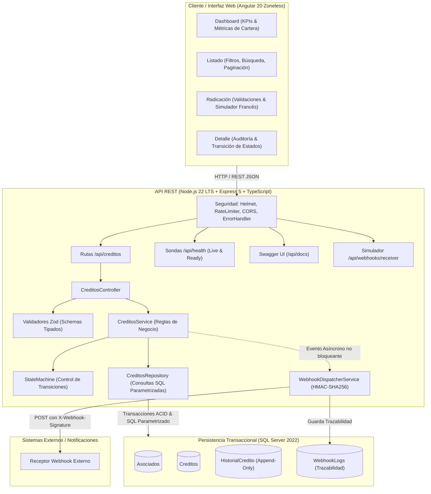
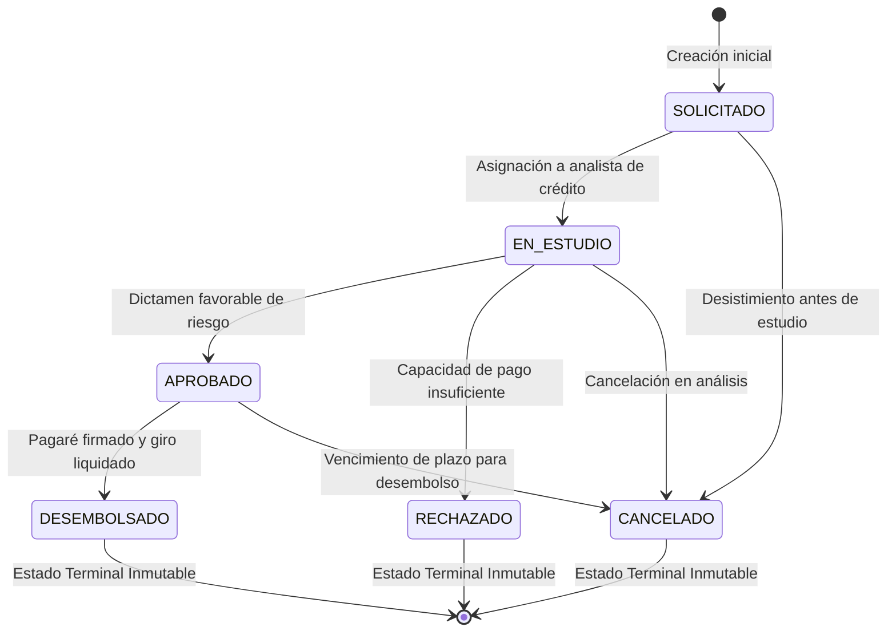

# Especificación de Requerimientos de Software (SRS) · CoopCréditos

**Módulo Core de Administración y Evaluación de Solicitudes de Crédito**  
*Sector Financiero Solidario (Cooperativas de Ahorro y Crédito, Fondos de Empleados y Mutuales)*

---

## 1. Propósito y Alcance del Sistema

El módulo **CoopCréditos** es una solución transaccional orientada a la administración del ciclo de vida integral de las solicitudes de crédito para entidades del sector solidario.

El sistema garantiza:
1. **Precisión Numérica Bancaria:** Almacenamiento y cálculo de intereses sin pérdidas de precisión por coma flotante (`DECIMAL(18,2)` y `DECIMAL(5,2)`).
2. **Determinismo en el Flujo de Estados:** Máquina de estados finita con guardas de transición estrictas.
3. **Auditabilidad Regulatoria Inmutable (*Append-Only*):** Trazabilidad completa de cada acción y cambio de estado con usuario, timestamp UTC y justificación.
4. **Conservación de Información:** Borrado lógico auditado (`isDeleted = 1`).
5. **Integración Asíncrona Resiliente:** Disparo de eventos a terceros vía webhooks con firma criptográfica HMAC-SHA256, sin bloquear la transacción principal.
6. **Experiencia de Usuario de Alto Rendimiento:** Interfaz moderna en Angular 20 Zoneless con Signals reactivos y simulador de cuotas en tiempo real.

---

## 2. Arquitectura del Sistema

---

## 3. Modelo Relacional de Base de Datos

### Entidades

#### 1. `Asociados`
Almacena los asociados activos del sector solidario con capacidad para radicar créditos.
- `id` INT IDENTITY(1,1) PRIMARY KEY
- `identificacion` NVARCHAR(20) NOT NULL UNIQUE (Índice único)
- `nombreCompleto` NVARCHAR(150) NOT NULL
- `email` NVARCHAR(100) NULL
- `telefono` NVARCHAR(20) NULL
- `fechaCreacion` DATETIME2(7) NOT NULL DEFAULT SYSUTCDATETIME()

#### 2. `Creditos`
Entidad principal transaccional.
- `id` INT IDENTITY(1,1) PRIMARY KEY
- `numeroCredito` VARCHAR(25) NOT NULL UNIQUE (Formato `CR-YYYY-######`)
- `idAsociado` INT NOT NULL FOREIGN KEY REFERENCES Asociados(id)
- `identificacionAsociado` NVARCHAR(20) NOT NULL (desnormalizado para indexación y filtros rápidos)
- `nombreAsociado` NVARCHAR(150) NOT NULL
- `tipoCredito` VARCHAR(30) NOT NULL (`LIBRE_INVERSION`, `VIVIENDA`, `EDUCATIVO`, `VEHICULO`, `CALAMIDAD`)
- `valorSolicitado` DECIMAL(18,2) NOT NULL (CHECK > 0)
- `tasaInteres` DECIMAL(5,2) NOT NULL (CHECK >= 0)
- `numeroCuotas` INT NOT NULL (CHECK > 0)
- `formaPago` VARCHAR(20) NOT NULL (`NOMINA`, `VENTANILLA`, `DEBITO_AUTOMATICO`)
- `estado` VARCHAR(20) NOT NULL (`SOLICITADO`, `EN_ESTUDIO`, `APROBADO`, `RECHAZADO`, `DESEMBOLSADO`, `CANCELADO`)
- `fechaSolicitud` DATETIME2(7) NOT NULL DEFAULT SYSUTCDATETIME()
- `fechaActualizacion` DATETIME2(7) NOT NULL DEFAULT SYSUTCDATETIME()
- `isDeleted` BIT NOT NULL DEFAULT 0 (Borrado lógico)

#### 3. `HistorialCredito` (Auditoría Inmutable)
Garantiza el principio *append-only* requerido por normativas de auditoría financiera (Superfinanciera / Supersolidaria).
- `id` INT IDENTITY(1,1) PRIMARY KEY
- `idCredito` INT NOT NULL FOREIGN KEY REFERENCES Creditos(id)
- `estadoAnterior` VARCHAR(20) NULL
- `estadoNuevo` VARCHAR(20) NOT NULL
- `usuario` NVARCHAR(100) NOT NULL (usuario del sistema o responsable de la decisión)
- `observacion` NVARCHAR(500) NULL (justificación de la transición)
- `fechaCambio` DATETIME2(7) NOT NULL DEFAULT SYSUTCDATETIME()

#### 4. `WebhookLogs` (Bitácora de Integración)
- `id` INT IDENTITY(1,1) PRIMARY KEY
- `eventId` VARCHAR(64) NOT NULL UNIQUE
- `idCredito` INT NOT NULL FOREIGN KEY REFERENCES Creditos(id)
- `url` NVARCHAR(500) NOT NULL
- `requestPayload` NVARCHAR(MAX) NOT NULL
- `responseStatus` INT NULL
- `responseBody` NVARCHAR(MAX) NULL
- `exitoso` BIT NOT NULL DEFAULT 0
- `intentos` INT NOT NULL DEFAULT 1
- `error` NVARCHAR(MAX) NULL
- `fechaCreacion` DATETIME2(7) NOT NULL DEFAULT SYSUTCDATETIME()

---

## 4. Reglas de Negocio y Ciclo de Vida

### Validaciones Financieras Estrictas
- **Monto Solicitado:** `DECIMAL(18,2)` estrictamente superior a $0.
- **Tasa de Interés:** `DECIMAL(5,2)` mayor o igual a 0%.
- **Plazo / Cuotas:** Entero positivo estrictamente mayor a 0 meses.
- **Simulación de Cuota:** Basada en sistema de amortización francés (cuota fija mensual):
  $$C = P \cdot \frac{i \cdot (1+i)^n}{(1+i)^n - 1}$$

### Control Antifraude y Solicitudes Duplicadas
Se previene la radicación concurrente o errónea respondiendo con código HTTP `409 CONFLICT` si:
1. El mismo asociado cuenta con una solicitud activa en estado preliminar (`SOLICITADO` o `EN_ESTUDIO`) para la misma línea de crédito radicada en los últimos 30 días.
2. O existe una solicitud en trámite con el mismo monto exacto y número de cuotas.

### Ciclo de Estados y Guardas

*Regla de inmutabilidad contractual:* Una vez que una solicitud alcanza los estados `APROBADO` o `DESEMBOLSADO`, queda prohibida cualquier alteración de sus términos financieros (monto, cuotas o tasa).

---

## 5. Webhook y Notificaciones Asíncronas

### Protocolo de Integración
- **Disparo Asíncrono no bloqueante:** La base de datos confirma primero la radicación; el webhook se envía inmediatamente en background sin degradar el tiempo de respuesta del usuario.
- **Firma Criptográfica HMAC-SHA256:** Cada petición incluye el encabezado `X-Webhook-Signature` computado con una clave simétrica secreta, garantizando autenticidad e integridad del mensaje.
- **Tolerancia a Fallos:** Respuestas 4xx/5xx o caídas de red del endpoint externo no revierten la radicación del crédito y quedan registradas detalladamente en `WebhookLogs` para reintento.

---

## 6. Especificación de Endpoints (API REST)

| Método | Endpoint | Descripción | Códigos HTTP |
|---|---|---|---|
| `GET` | `/api/health/live` | Sonda de liveness del contenedor | 200 |
| `GET` | `/api/health/ready` | Sonda de readiness (conexión activa a SQL Server) | 200, 503 |
| `GET` | `/api/docs` | Swagger UI interactivo (OpenAPI 3.0) | 200 |
| `GET` | `/api/creditos/stats` | KPIs consolidados para el Dashboard gerencial | 200, 500 |
| `POST` | `/api/creditos` | Radicación de solicitud con emisión de webhook | 201, 400, 409, 500 |
| `GET` | `/api/creditos` | Consulta paginada con filtros multicriterio | 200, 500 |
| `GET` | `/api/creditos/:id` | Detalle con auditoría e historial de webhooks | 200, 404, 500 |
| `PUT/PATCH` | `/api/creditos/:id` | Actualización de condiciones (solo estados editables) | 200, 400, 404, 422 |
| `PATCH` | `/api/creditos/:id/estado` | Transición transaccional de estado con justificación | 200, 400, 404, 422 |
| `DELETE` | `/api/creditos/:id` | Borrado lógico (`isDeleted = 1`) | 200, 404, 500 |
| `POST` | `/api/webhooks/receiver` | Receptor simulado para pruebas de integración | 200 |

---

## 7. Directrices de Seguridad y Cumplimiento

1. **Protección contra Inyecciones SQL:** Todas las consultas usan consultas parametrizadas tipadas con el driver nativo `mssql`.
2. **Validación de Esquemas en Frontera:** Toda petición es deserializada y sanitizada mediante esquemas de validación estricta con `Zod`.
3. **Hardening HTTP:** Cabeceras de seguridad administradas mediante `Helmet` (CSP, HSTS, X-Frame-Options).
4. **Protección contra Ataques de Denegación de Servicio:** Rate limiting por IP en todas las rutas operativas.
5. **Aislamiento de Secretos:** Cero credenciales en código fuente; uso estricto de variables de entorno con esquema de validación al arrancar el servicio.
