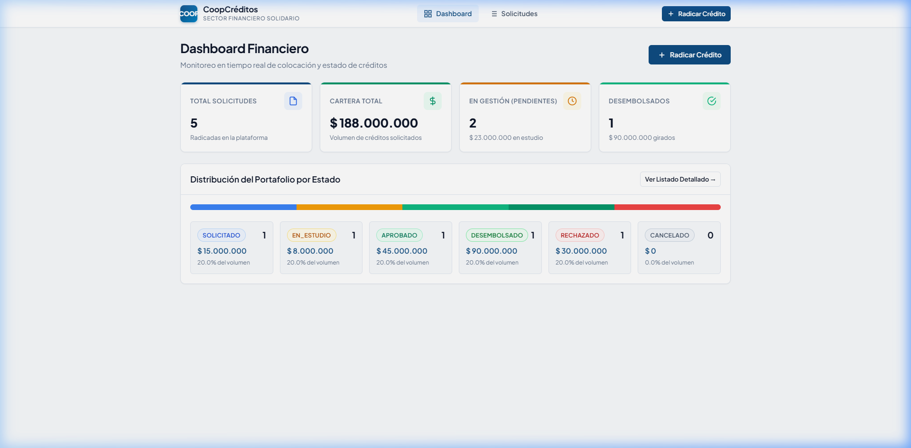
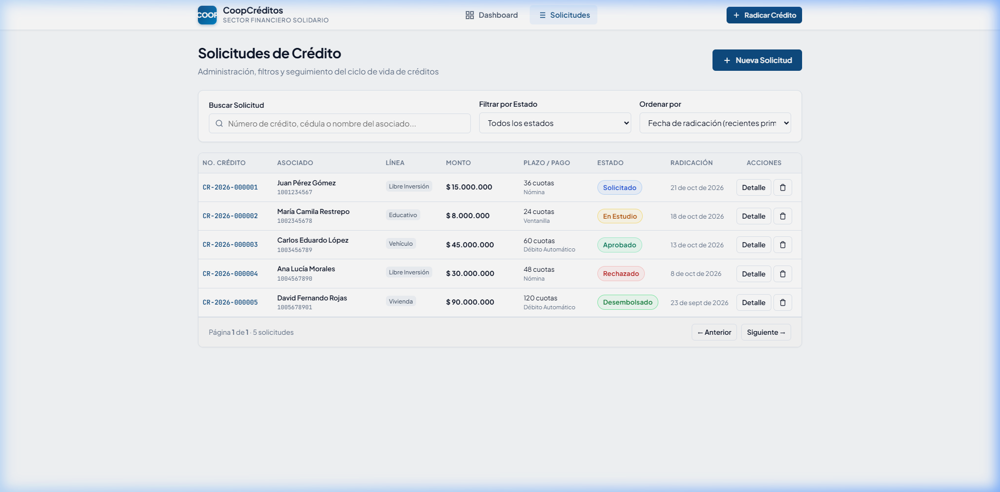
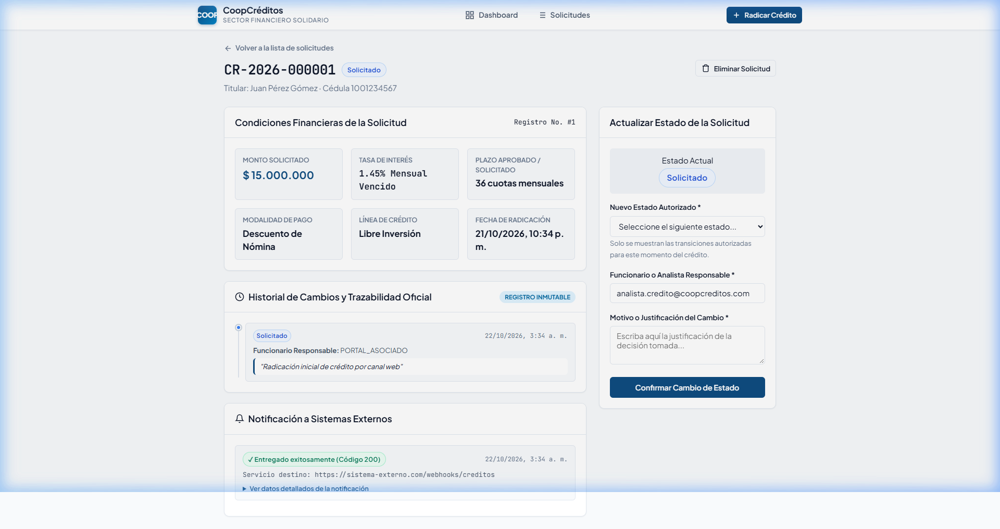
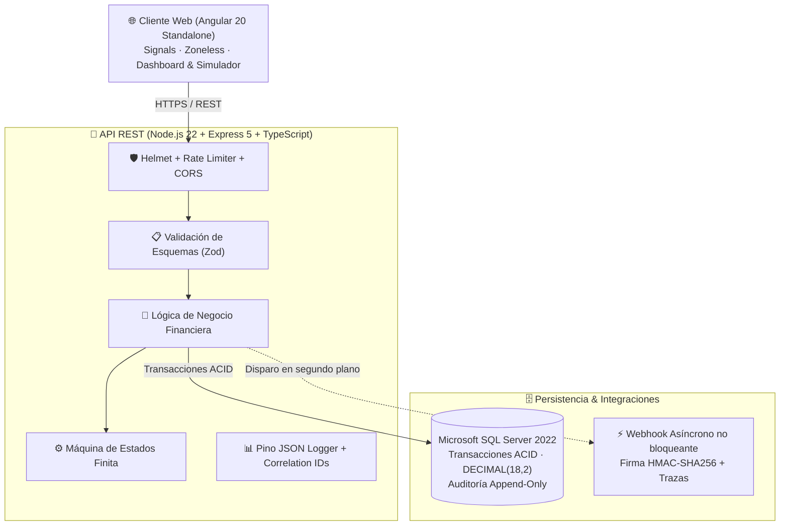
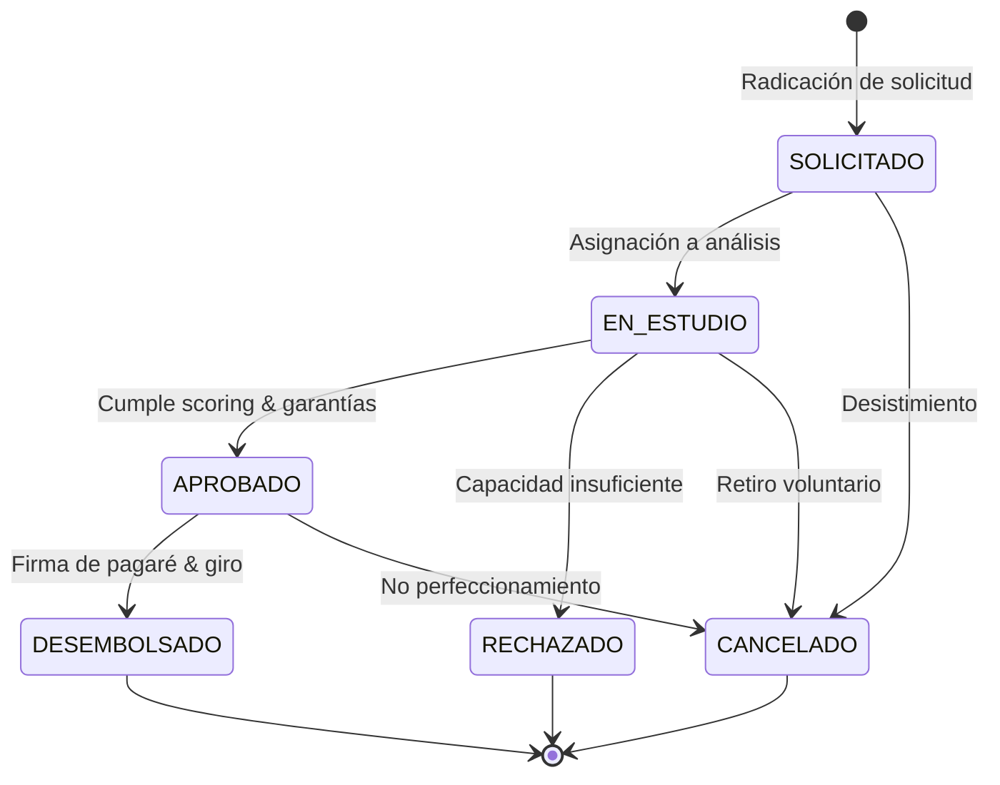

# CoopCréditos · Core Financiero de Solicitudes de Crédito

<p align="center">
  
  
  
  
  
  
  
</p>

Plataforma fullstack de nivel empresarial diseñada para la **gestión transaccional, evaluación, desembolso y auditoría de créditos** en entidades de la economía solidaria (cooperativas de ahorro y crédito, fondos de empleados y mutuales).

Implementa estándares bancarios de precisión numérica, máquina de estados determinista, auditoría *append-only*, webhooks asíncronos con firma criptográfica y arquitectura desacoplada lista para escalar.

---

## 📸 Capturas de la Aplicación

<div align="center">
  <p><strong>Dashboard Gerencial con KPIs de Cartera en Tiempo Real</strong></p>
  
  <br/><br/>
  <p><strong>Administración de Solicitudes con Filtros y Paginación</strong></p>
  
  <br/><br/>
  <p><strong>Detalle Integral: Historial de Auditoría Inmutable & Visor de Webhooks</strong></p>
  
</div>

---

## 🏛️ Características Principales

- **Precisión Bancaria Estricta (`DECIMAL(18,2)`):** Elimina cualquier imprecisión de coma flotante binaria en montos y tasas de interés.
- **Máquina de Estados Finita Determinista:** Ciclo de vida controlado (`SOLICITADO` ➔ `EN_ESTUDIO` ➔ `APROBADO`/`RECHAZADO` ➔ `DESEMBOLSADO`/`CANCELADO`) con guardas de negocio transaccionales.
- **Auditoría Inmutable (*Append-Only*):** Bitácora permanente en `HistorialCredito` con estampas de tiempo UTC, usuario responsable y justificación obligatoria.
- **Borrado Lógico Auditado (`isDeleted = 1`):** Ningún registro financiero desaparece físicamente, asegurando cumplimiento regulatorio de entes de control.
- **Integración Webhook Resiliente con HMAC-SHA256:** Notificaciones HTTP asíncronas no bloqueantes firmadas digitalmente, con bitácora completa de entrega (`WebhookLogs`).
- **Frontend Reactivo de Alta Eficiencia (Angular 20):** Arquitectura *Standalone* y *Zoneless* impulsada por Angular Signals para renderizado óptimo y reactividad sin sobrecarga de `zone.js`.
- **Seguridad en Profundidad:** Cabeceras HTTP endurecidas con `Helmet`, protección anti-abuso con `Rate Limiting`, validación tipada estricta con `Zod` y consultas SQL 100% parametrizadas (anti SQL Injection).
- **Observabilidad & Healthchecks:** Trazas estructuradas en JSON con `Pino` (con correlation IDs) y sondas `/api/health/live` y `/api/health/ready`.
- **Despliegue Orquestado en 1 Comando:** Entorno reproducible con Docker Compose y precarga automatizada de esquema relacional y datos de prueba.

---

## 📐 Arquitectura de la Solución



### Flujo de la Máquina de Estados del Crédito



---

## 🛠️ Stack Tecnológico

| Capa | Tecnologías |
|---|---|
| **Frontend** | Angular 20 (Standalone Components, Signals, Zoneless), TypeScript, CSS Modular Nativo |
| **Backend / API** | Node.js 22 LTS, Express 5, TypeScript 5.8, Zod 4, Pino Logger |
| **Base de Datos** | Microsoft SQL Server 2022 (Linux container), `mssql` pool transaccional |
| **Seguridad** | Helmet, Express Rate Limit, HMAC-SHA256 Payload Signing, Parameterized Queries |
| **Documentación** | OpenAPI 3.0 / Swagger UI interactivo |
| **Testing** | Jest, Supertest, TS-Jest (Unit & Integration tests) |
| **DevOps & Infra** | Docker, Docker Compose, Nginx (Alpine), Multi-stage Dockerfiles, GitHub Actions CI |

---

## ⚡ Inicio Rápido con Docker

La forma más rápida de ejecutar toda la solución es utilizando **Docker Compose**. El servicio `db-init` precarga automáticamente el esquema relacional, asociados y solicitudes de crédito en diferentes estados.

```bash
# 1. Clonar el repositorio
git clone https://github.com/julianstt8/coop-creditos.git
cd coop-creditos

# 2. Copiar variables de entorno
cp .env.example .env

# 3. Levantar los 4 servicios (SQL Server, DB-Init, Backend, Frontend)
docker compose up --build
```

Una vez levantado el entorno:

| Servicio | URL | Descripción |
|---|---|---|
| **Web App** | [http://localhost:8080](http://localhost:8080) | Interfaz operativa: Dashboard, radicación, simulador y auditoría |
| **API REST** | [http://localhost:4000/api](http://localhost:4000/api) | Endpoint base de la API |
| **Swagger UI** | [http://localhost:4000/api/docs](http://localhost:4000/api/docs) | Documentación interactiva de endpoints |
| **Health Liveness** | [http://localhost:4000/api/health/live](http://localhost:4000/api/health/live) | Monitoreo del proceso del servidor |
| **Health Readiness** | [http://localhost:4000/api/health/ready](http://localhost:4000/api/health/ready) | Verificación de conectividad a SQL Server |

---

## 💻 Desarrollo Local (Paso a Paso)

Si deseas ejecutar los servicios de forma individual en tu máquina local:

### 1. Base de datos con Docker
```bash
cp .env.example .env
docker compose up -d sqlserver db-init
```

### 2. Backend (API REST)
```bash
cd backend
npm install
npm run dev        # Escuchando en http://localhost:4000
```

### 3. Frontend (Web Angular 20)
```bash
cd frontend
npm install
npm start          # Escuchando en http://localhost:4200 (con proxy a :4000)
```

### 4. Pruebas Automatizadas
```bash
cd backend
npm test           # Ejecuta suite con Jest y Supertest
```

---

## 🔌 Catálogo de Endpoints (API REST)

| Método | Ruta | Descripción | Guardas / Reglas |
|---|---|---|---|
| `GET` | `/api/health/live` | Liveness check | Verifica que el proceso responda |
| `GET` | `/api/health/ready` | Readiness check | Valida conectividad y query activa a SQL Server |
| `GET` | `/api/docs` | Swagger UI | Documentación interactiva OpenAPI |
| `GET` | `/api/creditos/stats` | Estadísticas gerenciales | Total de créditos, montos colocados y distribución por estado |
| `POST` | `/api/creditos` | Radicar solicitud | Valida asociado existente, calcula código único `CR-YYYY-######` y emite webhook |
| `GET` | `/api/creditos` | Listar solicitudes | Paginación `page`/`pageSize`, filtros por estado, asociado y rango de fechas |
| `GET` | `/api/creditos/:id` | Detalle integral | Incluye datos del titular, historial de auditoría y trazas del webhook |
| `PUT/PATCH` | `/api/creditos/:id` | Editar condiciones | Permitido **únicamente** en estados preliminares (`SOLICITADO`, `EN_ESTUDIO`) |
| `PATCH` | `/api/creditos/:id/estado` | Transición de estado | Aplica máquina de estados, validación transaccional y registro en `HistorialCredito` |
| `DELETE` | `/api/creditos/:id` | Anulación / Borrado lógico | Aplica `isDeleted = 1`, preservando trazabilidad para auditorías |
| `POST` | `/api/webhooks/receiver` | Receptor simulado | Endpoint de prueba con verificación de firma criptográfica HMAC-SHA256 |

---

## 📁 Estructura del Proyecto

```text
coop-creditos/
├── .github/
│   └── workflows/
│       └── ci.yml             # Pipeline de Integración Continua (GitHub Actions)
├── backend/                   # Microservicio API REST
│   ├── src/
│   │   ├── config/            # Variables de entorno y pool de conexión SQL Server
│   │   ├── modules/
│   │   │   └── creditos/      # Controladores, servicios de negocio, repositorios y esquemas Zod
│   │   ├── shared/            # Manejo centralizado de errores, logger Pino y máquina de estados
│   │   ├── app.ts             # Ensamblado de middlewares y rutas Express 5
│   │   └── server.ts          # Inicialización y Graceful Shutdown
│   ├── tests/                 # Suite de pruebas unitarias y de integración (Jest + Supertest)
│   └── Dockerfile             # Multi-stage build para producción
├── frontend/                  # Aplicación Web SPA (Angular 20 Zoneless)
│   ├── src/app/
│   │   ├── core/              # Modelos tipados y servicios HTTP
│   │   ├── features/          # Dashboard, radicación, listado y detalle con auditoría
│   │   └── shared/            # Componentes reutilizables, simulador de cuotas y pipes
│   ├── nginx.conf             # Servidor web de alto rendimiento para el build productivo
│   └── Dockerfile             # Multi-stage build con Nginx Alpine
├── database/                  # Scripts DDL y DML
│   ├── 01_create_database.sql # Creación de BD
│   ├── 02_schema.sql          # Tablas, índices, claves foráneas y restricciones
│   └── 03_seed.sql            # Datos maestros iniciales de asociados y créditos de prueba
├── docker-compose.yml         # Orquestación de contenedores
├── DECISIONES_TECNICAS.md     # Justificación técnica profunda y diseño para escalar a 500k créditos/mes
└── EXPLICACION_SOLUCION.md    # Explicación ejecutiva de la solución y casos de uso
```

---

## 🚀 Arquitectura para Escalar (500 a 500.000 créditos/mes)

El sistema fue diseñado desde su concepción considerando patrones de crecimiento empresarial:

1. **Multi-tenancy Aislado:** Soporte para múltiples cooperativas mediante esquema híbrido (Row-Level Security por `tenantId` y bases de datos aisladas para grandes cuentas).
2. **Segregación de Consultas y Comandos (CQRS):** Separación de escrituras transaccionales hacia réplicas de lectura indexadas para reportería masiva sin degradar la operación.
3. **Event-Driven Architecture (Kafka / RabbitMQ):** Desacoplamiento de eventos de negocio (evaluación en centrales de riesgo, notificaciones y webhooks) mediante colas asíncronas con reintentos exponenciales y dead-letter queues.
4. **Capa de Caché de Alto Rendimiento (Redis):** Reducción de hasta un 70% de la carga de base de datos en catálogos y consultas de scoring repetitivas.

---

## 📚 Documentación Técnica Detallada

Para una inmersión profunda en la ingeniería detrás del proyecto, consulta los documentos de referencia:
- 📋 **[Especificación de Requerimientos de Software (SRS)](ESPECIFICACION_REQUERIMIENTOS.md):** Modelo relacional, ciclo de vida de crédito, reglas antifraude y contratos REST.
- 📐 **[Decisiones Técnicas y Escalabilidad](DECISIONES_TECNICAS.md):** Justificación de precisión bancaria, diseño para escalar a 500k créditos/mes, CQRS, Redis, colas de eventos y multi-tenancy.
- 💡 **[Explicación de la Solución](EXPLICACION_SOLUCION.md):** Resumen ejecutivo de la arquitectura y flujo funcional.

---

## 🧪 Calidad de Código y Pruebas

El proyecto cuenta con cobertura de pruebas automatizadas que verifican:
- Reglas de negocio de la máquina de estados y transiciones prohibidas.
- Inmutabilidad de créditos en estados finales (`APROBADO`, `DESEMBOLSADO`).
- Cálculo financiero exacto de amortización y validación de tipos Zod.
- Endpoints de la API REST mediante pruebas de integración con `supertest`.
- Verificación estricta de tipos TypeScript (`typecheck`) y formateo estandarizado con Prettier.

---

## 📄 Licencia

Este proyecto está bajo la Licencia [MIT](LICENSE).

---

## 👤 Autor

Desarrollado por **Julián Londoño**  
- **GitHub:** [@julianstt8](https://github.com/julianstt8)
